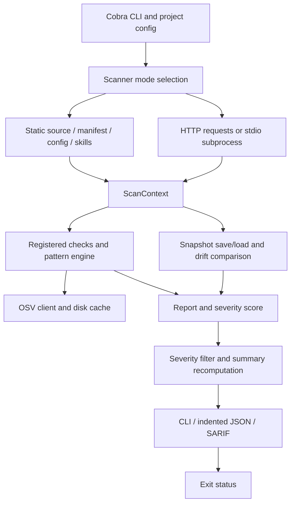

# Repository audit — 22 October 2026

## Verified checkout and scope

- Root: `C:/dev/MCPSense`; remote `https://github.com/fayzkk889/MCPSense.git`.
- Branch `main`; HEAD `9c19c629fe2704a0094944397a090152ebd2e3ac`. Initial working tree clean. No branch, commit, dependency install or production edit performed in this first session.
- Local latest tag `v0.3.0`; public releases page also identifies v0.3.0 as latest. Public assets, signatures and CI runs were not independently verified. `gh release list --limit 3 --repo fayzkk889/MCPSense` failed connecting to api.github.com.
- Go module `github.com/fayzkk889/MCPSense`, minimum Go 1.22. Installed Go 1.27.3 windows/amd64. MIT license unchanged.
- Production execution paths, models, representative rule implementations, existing test structure, installers and all three workflows were inspected. This is a scoped first-pass audit, not exhaustive line-by-line verification of every rule or fixture. Website source was not present; a separate website repository was not established.

## Architecture

| Component | Actual capability and source |
| --- | --- |
| CLI | `cmd/mcpsense/main.go`: scan/version/init, project JSON settings, mode/rule/severity filters, offline/no-cve flags, output and baseline writes |
| Scanner | `internal/scanner/scanner.go`: five concrete modes plus auto; `static.go` discovers source, one manifest and first matching config; `manifest.go` parses JSON; `skill.go` finds agent instructions |
| Live | `internal/scanner/live.go`: legacy initialize/list sequence, HTTP JSON posts and newline stdio; no current-era discovery, pagination, proper SSE parser or tool calls |
| Rules | `internal/checks/registry.go:35`: 32 registered checks (5 spec, 16 SEC, 3 skill, 1 CVE, 7 quality); 7 drift IDs are emitted separately. These are implementations, not 39 independent security guarantees |
| Detection | `internal/detection`: regex patterns, description/source filters, Unicode/poisoning heuristics through checks; not dataflow or exploit verification |
| Advisories | `internal/checks/cve.go`, `internal/cve`: command-derived package/version guesses, OSV lookup, 24h cache freshness and stale fallback; not complete dependency resolution |
| Drift | `internal/drift`: SHA-256 field hashes plus plaintext metadata, default per-target snapshots under user home; auto-saved on first manifest/config/live scan |
| Reports | `internal/models`, `internal/report`: severity-weighted score, summary, OWASP mapping, CLI/JSON/SARIF; no coverage or verification-state model, no per-instance fingerprint |
| Release | `.goreleaser.yml`, `.github/workflows/release.yml`: tag-triggered public release, checksums, five build targets, MIT and README in archives; `before` hook runs go mod tidy |
| Distribution | `action.yml`, shell/PowerShell installers, npm wrapper: downloads or Go source install; no evaluated signing step in release workflow despite code-signing policy claims |

README line 11 advertises 27 checks / 4 modes; CLI also has skill mode. `EnableProbe` is set but no operative probe path was found. SARIF and live client identify version 0.2.2 while latest tag is 0.3.0. CI uses Go 1.22 Ubuntu; no race or runtime platform matrix. Action self-test is manual and sets fail-on none, so it cannot establish security threshold correctness.

## Confirmed defects

Priorities below are engineering urgency, not assigned CVSS or public vulnerability IDs. Runtime reproductions are audit-only `docs/engineering/repro/main.go`; no real credentials or remote endpoints used.

| Priority | Evidence and outcome | Impact / qualification |
| --- | --- | --- |
| P0 | `drift/drift.go:28,38,60`, `store.go:60`: synthetic secret survives snapshot serialization and actual temporary-file Save | Descriptions and args retained by default. Environment VALUES are excluded, a useful existing mitigation. Target/resource URI can also retain credentials by source inspection |
| P0 | `drift/drift.go:140,233`, `models/finding.go:30`, `report/json.go`: synthetic old description survives ordinary JSON marshaling of drift findings | JSON exposes before/after regardless of CLI show-diff. Config rule descriptions also embed commands/args; no centralized redaction |
| P0 | `cmd/mcpsense/main.go:139-146,253`, `scanner/scanner.go:34`: offline reduces to DisableCVE. Harness with same scanner option makes four mocked HTTP requests | CLI promise “Disable all network calls” is false by source trace and scanner reproduction; CLI binary run blocked by dependency cache |
| P0 | `scanner/live.go:69-133`: four HTTP 503 JSON-RPC errors return a report and nil error | Incomplete enumeration can look like a completed scan; result is not necessarily score 100 because spec checks may flag missing metadata |
| P0 | `detection/patterns.go`, Scan/scanWithFilter: lowercased byte offsets slice original string | `Ⱥ` repeated 100 times plus injection phrase produces recovered slice panic. Attacker-controlled descriptions can crash scanner. Both matching functions share pattern |
| P0 | `action.yml:65,120-127,161`: inputs substituted into Bash source | Confirmed source-to-shell injection pattern per GitHub guidance. Harmful exploit not executed. Harmless shell proof provided but Bash startup blocked by sandbox |
| P0 | `action.yml:132-134,181-184`: compact JSON regex applied to indented JSONReporter output | Go regex reproduction: score match is only `"score":`, no numeric value; high-severity pattern fails. Defaults can falsely give zero counts and passing threshold |
| P0 | `action.yml:129,145,167-169`: recorded SCAN_EXIT not enforced, SARIF errors swallowed, missing report explicitly passes | Source-confirmed fail-open logic. No full runner integration executed |
| P1 | `scanner/scanner.go:156`, `skill.go`: mixed source plus AGENTS.md chooses skill only | Reproduced auto missing SEC-002, explicit static detecting it. Directory auto should aggregate relevant coverage |
| P1 | `checks/registry.go` RunByIDs: unknown ID ignored | Reproduced unknown-rule scan returns score 100, no findings, no error |
| P1 | `scanner/live.go:17,52`, `checks/spec_compliance.go`: legacy-only lifecycle/version allowlist | No 2026-07-28 support; no Accept/protocol header/session management, response ID/error/status checks, bounded reads, capability gating or pagination. “SSE” name overstates implementation |
| P1 | `action.yml:125,141,145` separate scans, second --no-baseline | Source-confirmed report divergence: a baseline-change JSON finding is structurally excluded from SARIF scan. Repeated live scans also observe different states |
| P1 | `checks/cve.go:34`, `cve/osv.go:99`: unavailable advisory lookup silently becomes no CVE finding; later package failures ignored by aggregate ok flag | Source-confirmed uncertainty loss; stale cache is not reported as stale. Four-second budget is per package rather than total phase |

## Threat boundaries and additional risks

| Boundary | Existing behavior and missing control |
| --- | --- |
| Filesystem / client configs | JSON parses without command execution in explicit static/config modes. Static loader unconditionally appends home configs despite comment saying only on home scan; can inspect unrelated private configuration. No input-size/total-byte budget; symlinked source files may be read through os.ReadFile |
| Tool descriptions/schema/annotations | Treated as data by scanner, not model instructions; heuristic rules overstate some conclusions (read-only hint loss does not prove actual write capability). Unicode offset crash confirmed; full schema validation absent |
| Remote responses / URLs | Ten-second HTTP timeout exists. Default redirect behavior, no destination-address policy, unbounded decoder and no SSE framing. SSRF/DNS-rebinding exploit not dynamically tested |
| Processes / environments | exec.Command uses argument array, not implicit shell; strings.Fields breaks quoted Windows paths. Auto can select execution for executable/command target. Inherits environment, lacks context/process-tree cancellation; timeout can leave reader goroutine alive before subsequent reads. Descendant cleanup/races not reproduced |
| Advisory API/cache | TLS and per-call timeout; no response byte limit, freshness in report or complete package grammar. Package/server metadata can be sent externally in normal config scans; code-signing policy's “unless requested” privacy wording needs clarification |
| Reports / baselines | Save requests 0600 and directory 0755, but mode does not establish Windows ACL privacy. WriteFile follows links and does not harden existing permissive files or use atomic replace; default baseline auto-write. Explicit baseline errors only warn |
| Actions / artifacts | Inputs cross shell boundary, zero defaults mask parser failure, separate scans, no checksum verification on downloaded binaries. Stale files could be consumed after failure. Runtime reproduction blocked; source evidence is explicit |
| CI / release | Mutable action tags, latest linter/releaser, CI has no explicit permission restriction, only Linux runtime. Release workflow has contents:write and tag push publishes directly. No new tag should be pushed without approval |

Other limitations: map iteration can alter findings order; raw schema hashing flags whitespace changes; snapshot lacks format version, deletion tracking and target/policy validation; score measures remaining reported findings rather than confidence/coverage. SARIF remediation `fixes` only carries descriptions and should be checked against official schema before claiming conformance. Current output opening truncates existing files and does not guard target/output collisions. These were source observations, not all runtime-tested vulnerabilities.

## Baseline and compatibility

See [test-report.md](test-report.md). Full suite/build/vet/race/module verification did not pass because dependencies were absent and cache writes denied; no dependency installed. Dependency-free harness completed with all listed defect observations. Native Windows behavior was exercised only for that harness. Linux/macOS/WSL runtime, Go 1.22 and release builds remain unverified.

Prioritize P0 regression tests and fixes before release preparation. Preserve explicit scan modes and MIT; new execution policy and snapshot migration require compatibility documentation. Choose patch versus minor after actual scope is tested; do not predetermine version. A public release remains pending engineering and maintainer approval.

Implementation note (22 October): this audit describes original HEAD 9c19c62. Its original file/line references are historical. Fixes, compatibility changes, executed evidence and residual limitations are recorded in release-notes-0.4.0.md, test-report.md and release-readiness.md; consult current source rather than treating every original defect as still present.
